# Slime developer documentation

Slime is a local-first self-healing DevOps agent for explicitly configured
services. It monitors signals, groups incidents, diagnoses likely causes,
proposes typed repairs, applies a deterministic safety policy, and verifies recovery.

The local core needs **Python 3.10+**. Docker, a model, a GPU and API keys are
optional. **Repairs are dry-run by default.** `selfheal init` scans the local host
(log files, systemd units, Docker containers, listening ports and `nginx.conf`
upstreams) to write an explicit starter `config.yaml` for operator review. The
verified native recovery path starts a stopped or crashed process that Slime is
configured to own. Slime does not fix arbitrary application bugs.

## Install from source

```sh
git clone https://github.com/avirooppal/Slime.git
cd Slime
```

Windows PowerShell:

```powershell
py -3 -m venv .venv
.venv\Scripts\python -m pip install -e ".[dev]"
.venv\Scripts\Activate.ps1
```

Linux/macOS:

```sh
python3 -m venv .venv
.venv/bin/python -m pip install -e '.[dev]'
source .venv/bin/activate
```

Commands below assume this environment is activated. If activation is unavailable,
use `.venv\Scripts\slime` on Windows or `.venv/bin/slime` on Linux/macOS from
the repository root. `python -m selfheal` is another entry point; the legacy
`selfheal` command remains compatible with `slime`.

The distribution is `slime-selfheal` and is not published to PyPI (`selfheal` on
PyPI is an unrelated third-party package: `OpenExcept`'s debugger library). Always
install from a local clone with `pip install -e .` or `pip install -e ".[dev]"`.

## First run: Day 0 setup (`init` -> `doctor` -> `run`)

Scan the machine and generate an explicit starter `config.yaml`:

```sh
selfheal init
selfheal doctor
selfheal run --once
```

`selfheal init` refuses to overwrite an existing `config.yaml`, sets `dry_run: true`,
leaves `safety.enabled_actions: []` (so nothing auto-runs until you explicitly run
`selfheal enable-action`), auto-marks stateful/database targets `critical: true`,
and wires the discovered dependency map. Press Ctrl+C to stop continuous monitoring,
or pass `--once` for a single cycle.

## Try a real recovery locally

The included playground is a disposable HTTP service. It begins offline so you
can observe detection, a dry-run proposal, enabling an action, and actual recovery:

```sh
cd examples/playground
python setup.py
selfheal run --config .slime/config.yaml --once
```

Expect `restart_managed_process` and the `dry_run` policy rule. The application
stays offline. Enable `restart_managed_process` and run one live cycle:

```sh
selfheal enable-action restart_managed_process --config .slime/config.yaml
selfheal run --config .slime/config.yaml --no-dry-run --once
python check.py
```

Expect execution `success`, verification `Stable`, and healthy JSON containing
the app's PID and uptime. `check.py` also prints the browser-accessible health
URL. The example uses a five-second stability window; the normal default is
120 seconds.

Inspect the incident, then stop the disposable service:

```sh
selfheal incidents --config .slime/config.yaml
python check.py stop
```

Omit `--once` to keep monitoring. Ctrl+C stops the agent, **not its managed child**;
stop monitoring before using `check.py stop`. The stop helper checks the child's
recorded PID and birth time. Immediate repeated failures can trigger cooldown or
flapping protection; the example leaves these protections enabled.

## Configure managed processes

For a managed service in `config.yaml`:

```yaml
services:
  - name: worker
    managed_process:
      executable: /usr/bin/python3
      args: [-m, my_worker]
      cwd: /opt/my_worker
      startup_grace_seconds: 5
    http_url: http://127.0.0.1:9000/health
```

Executable and working-directory paths must be absolute. Managed children receive
a minimal environment (Windows `SystemRoot` only; empty on POSIX), so they do not
inherit shell secrets or the agent's cloud key. Slime records PID and birth time,
refuses duplicate startup when an unowned endpoint is already healthy, and verifies
the configured probe after startup. Without HTTP/TCP probes it verifies process
liveness only. It cannot adopt arbitrary PIDs or restart an already-running
unhealthy process.

## Configuration and commands

All operator commands default to `config.yaml` (pass `--config PATH` to use another file):

| Command | Purpose |
| --- | --- |
| `selfheal init` | Scan local host and write starter `config.yaml` (`dry_run: true`, `enabled_actions: []`, refuses overwrite). |
| `selfheal doctor` | Inspect grouped diagnostics (`Collectors`, `Diagnosis`, `Safety`, `Platform`), host capability table, and one-line fixes. |
| `selfheal status [--json]` | One-screen summary of mode banner, system health, open incidents, active pipeline, and safety gates (`NO_COLOR` respected). |
| `selfheal incidents [<id>] [--json]` | 80-column one-line incident table or `<id>` detail view (`would have auto-executed` / `would have needed approval` shown only for unacted dry-run incidents; resolved incidents show actual action, verification result, and duration). |
| `selfheal run` | Run polling, correlation, diagnosis, policy, execution and postmortem (`dry_run: true` by default). |
| `selfheal enable-action <actions...>` | Enable auto-execution only for specified `SAFE` actions; default `enabled_actions` is `[]`. |
| `selfheal approve <id_or_digest>`, `reconcile <action_id>` | Approve a staged proposal (refuses and lists digests if >1 proposal is staged) or reconcile an interrupted action. |
| `selfheal dry-run`, `kill-switch on\|off`, `reset-circuit` | Manage local safety controls. |
| `selfheal bench`, `eval` | Run the 7-case smoke test (`bench`) or evaluate optional held-out Laya routing (`eval`). The `bench` scenarios and runbooks were written together in this repository, so its scores are a regression smoke test, not an accuracy measurement. |
| `selfheal chaos`, `dashboard [--demo]` | Optional fault-injection runner (`chaos`) and localhost-only FastAPI web UI (`dashboard`, or `dashboard --demo` for read-only chaos-seeded demo). |

## Optional localhost dashboard

The optional browser dashboard is a self-contained, zero-CDN, offline single-page application served by FastAPI:

```sh
# Install from the repository root
python -m pip install -e ".[dashboard]"

# Serve your live config.yaml (requires session token printed in terminal)
selfheal dashboard --config config.yaml --port 8050

# Or launch the read-only seeded demo database covering all states
selfheal dashboard --demo --port 8050
```

Open the printed URL (`http://127.0.0.1:8050/?token=<session_token>`).
- **Security**: Bound strictly to `127.0.0.1`; requires the per-session random token on every request; rejects DNS-rebinding `Host` headers and cross-origin `Origin` headers; enforces `X-CSRF-Token` / `Bearer` on `POST /api/approve`, `/api/reject`, `/api/kill-switch`, and `/api/dry-run`; records `actor="dashboard"` in the append-only SQLite audit log; renders all untrusted log evidence via DOM `createTextNode` (zero `innerHTML` with data).
- **Accessibility & Visual System**: Light and Dark themes (`prefers-color-scheme` + manual toggle), WCAG 2.1 AA verified contrast ratios, keyboard tablist navigation (`Tab`, `ArrowRight`/`ArrowLeft`, `Home`/`End`, `Escape`), `prefers-reduced-motion`, ARIA live regions, and responsive layout down to `375px` mobile viewports. See [docs/DESIGN.md](docs/DESIGN.md) for the complete visual system specification.

### Overview (Light & Dark Themes)

Answers four operator questions in under five seconds: *Is everything OK? What is the agent allowed to do right now? Does anything need me? What did it just do?*

| Light Theme (Desktop) | Dark Theme (Desktop) |
| :---: | :---: |
|  |  |

| Calm All-Clear State (Light) | Learning Period Indicator (Dark) |
| :---: | :---: |
| 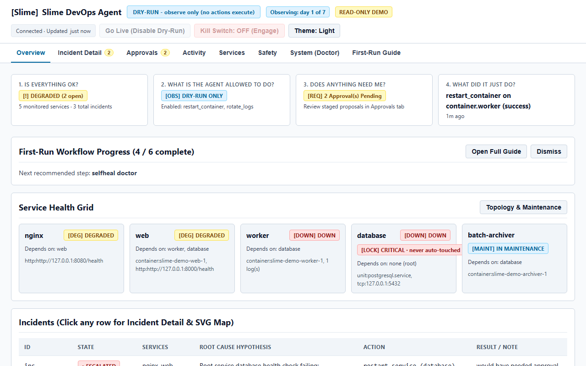 | 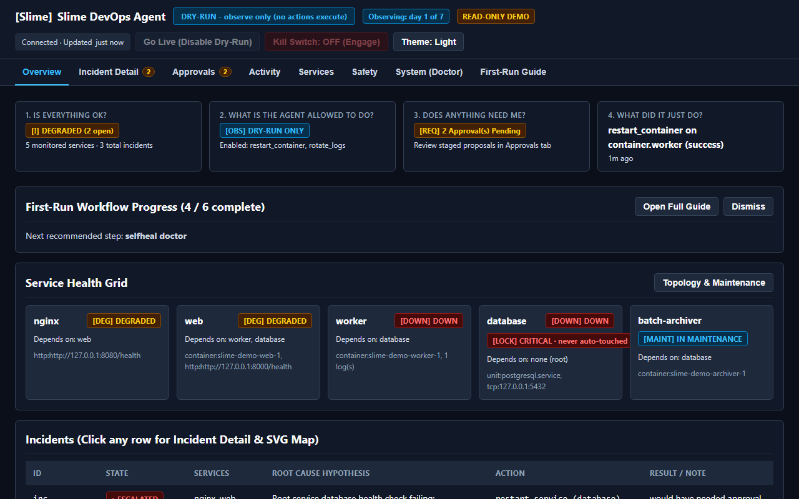 |

### Incident Detail & 11-Gate Deterministic Policy Check

Displays the inline SVG service dependency graph (root cause highlighted, downstream symptoms muted), ranked hypotheses across tiers, live target snapshot, ordered 11-gate policy evaluation showing the exact stopping rule, verification window progress, and postmortem report:

| Incident Detail (Light) | Incident Detail (Dark) |
| :---: | :---: |
| 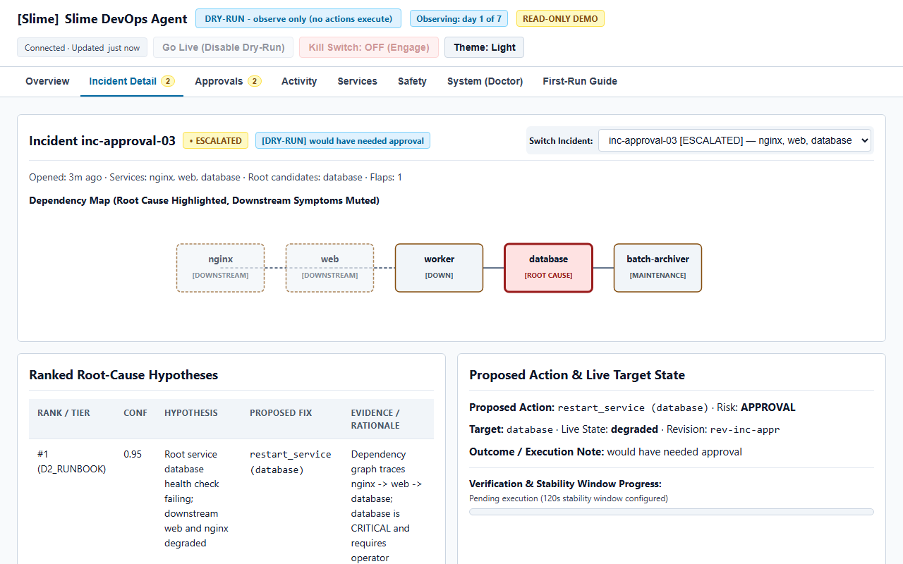 | 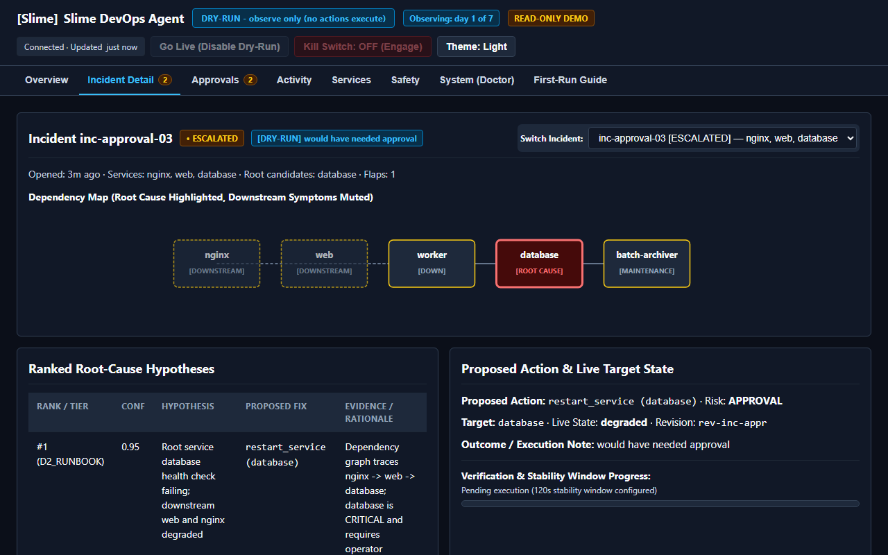 |

### Operator Approvals & Activity Audit Log

Stages single-use, revision-locked, time-limited proposals separately per incident with copyable SHA-256 digests, and logs all executions and plain-English policy refusals (`refused: cooldown, 4 min left`):

| Pending Approvals Queue (Light) | Activity & Audit Log (Dark) |
| :---: | :---: |
| 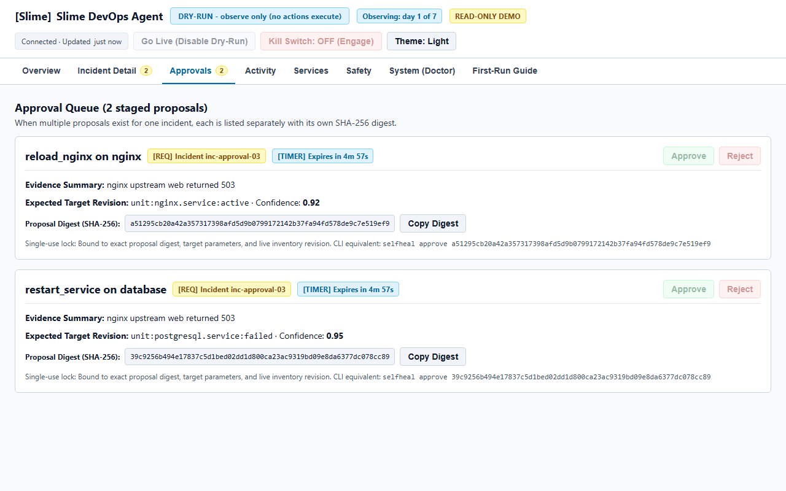 | 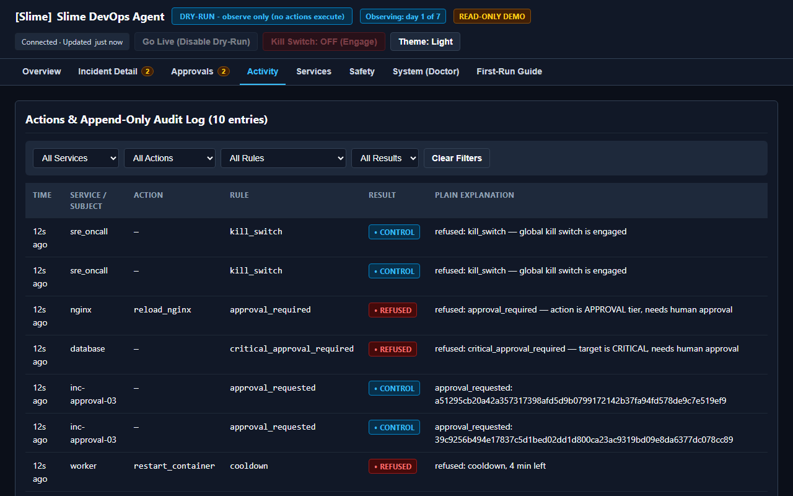 |

### Services Topology, Safety Controls & System Doctor

| Services & Dependency Graph (Light) | Safety Controls & Circuit Reset Steps (Dark) |
| :---: | :---: |
| 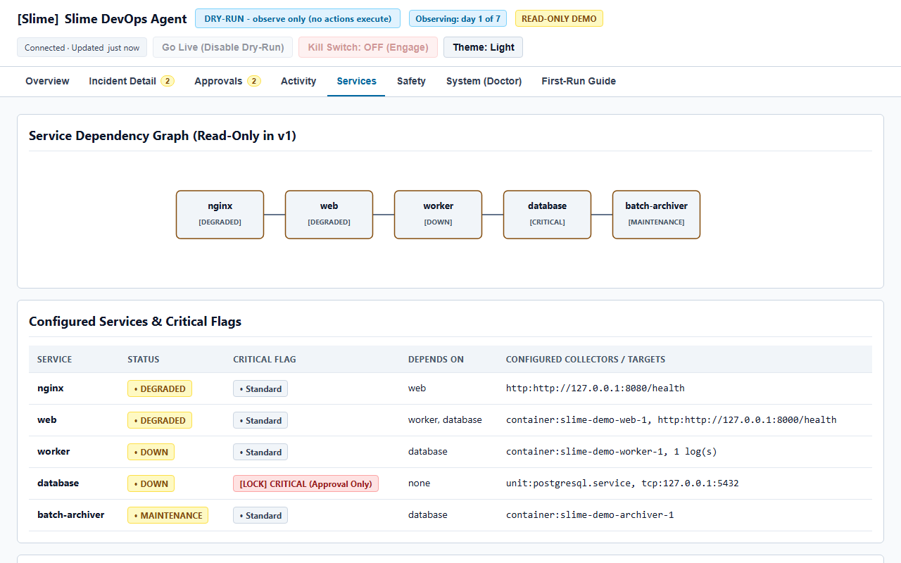 | 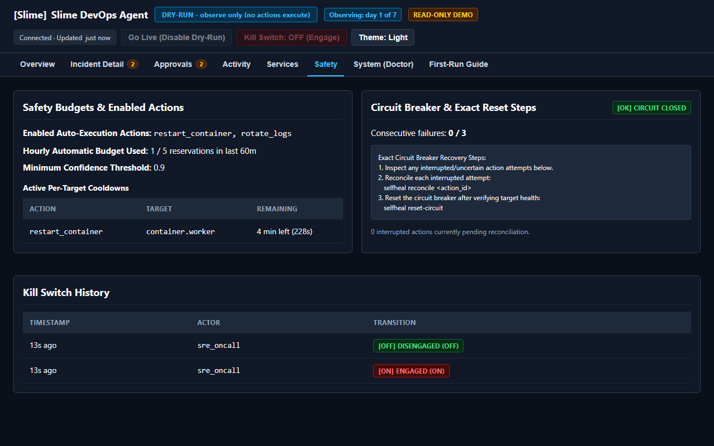 |

| System Doctor & Host Capabilities (Light) | First-Run Operational Guide (Dark) |
| :---: | :---: |
| 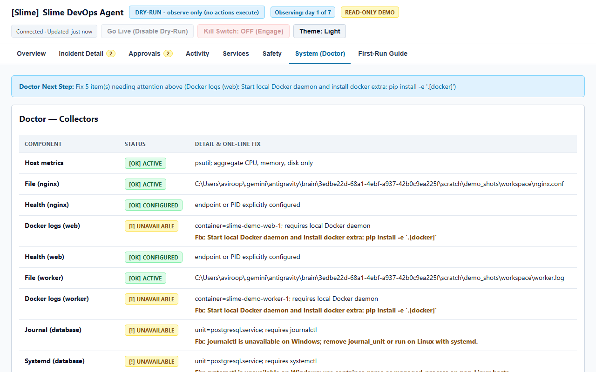 | 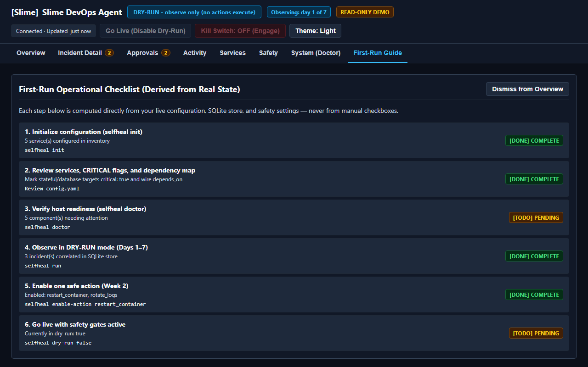 |

### Safety & Connection States (`HALTED`, `CIRCUIT OPEN`, `DISCONNECTED`, Mobile `375px`)

| Halted by Kill Switch (Light) | Circuit Breaker Open (Dark) |
| :---: | :---: |
|  |  |

| Disconnected Stale-Data Protection | Mobile Viewport (`375x812`) |
| :---: | :---: |
| 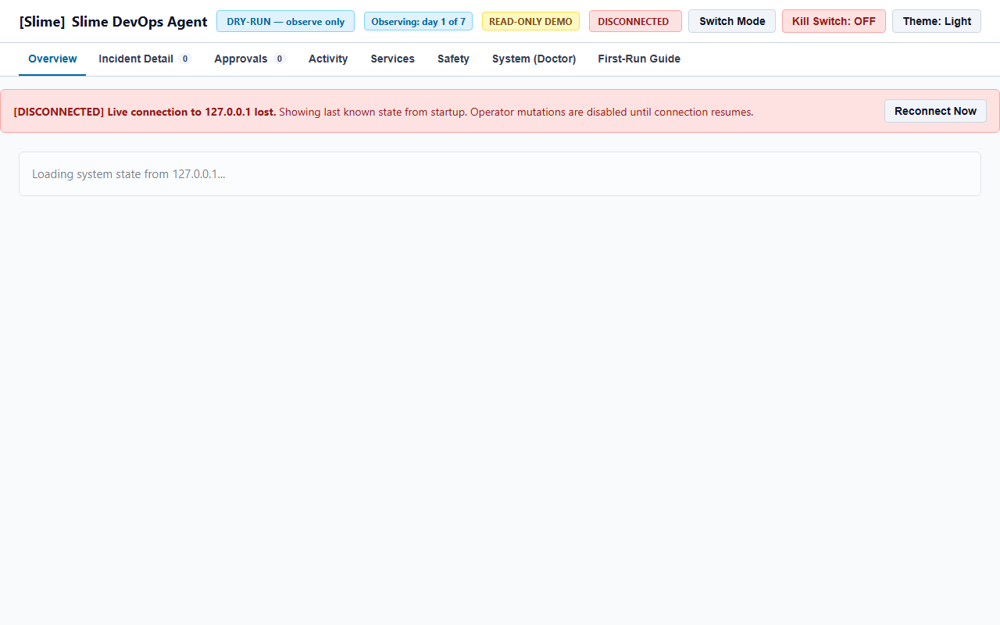 | 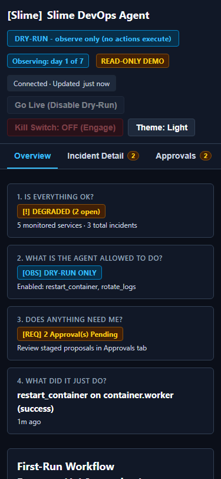 |

## Runtime architecture

One process coordinates the following stages in `selfheal/runtime.py`:

1. Collect configured health, log, container-log, host-metric and change signals.
2. Detect anomalies and correlate related events into incidents.
3. Diagnose using local retrieval, runbooks and optional model tiers.
4. Rank typed action proposals and evaluate the deterministic safety policy.
5. Execute permitted actions, verify stability, and record outcomes/postmortems.

| Source directory | Responsibility |
| --- | --- |
| `selfheal/collectors`, `signals` | Read sources, mine log templates and detect anomalies. |
| `selfheal/correlator`, `storage` | Correlate dependencies and persist incidents/audit records in SQLite. |
| `selfheal/diagnosis`, `learning` | BM25 retrieval, runbooks, bounded investigation and verified-outcome learning. |
| `selfheal/planner`, `safety` | Rank proposals; enforce kill-switch-first policy, inventory, confidence, approval and execution limits. |
| `selfheal/remediation`, `verifier` | Dispatch registered actions and verify stability. |
| `selfheal/interface` | CLI commands, host discovery and optional browser dashboard. |
| `selfheal/chaos`, `eval` | Isolated scenarios and evaluation tooling. |

D1 local retrieval and D2 runbooks form the baseline. D3 Ollama is optional at
`127.0.0.1:11434`; D4 cloud and D5 Laya require explicit configuration. Laya
also requires a passing held-out evaluation. Optional install extras are
`[docker]`, `[dashboard]`, `[embed]`, `[laya]` and `[cloud]`. Missing optional
components should degrade without disabling the local core.

## Development and validation

From the repository root with `[dev]` installed:

```sh
python -m pytest -q -ra
python -m ruff check selfheal tests
python -m mypy selfheal --ignore-missing-imports
python -m pip check
git diff --check
```

The playground was checked with real HTTP startup, stability verification and
identity-bound cleanup. This is local validation, not a production reliability
claim. GitHub Actions defines Python 3.10/3.12 jobs on Ubuntu and Windows, and
`scripts/linux_trial.sh` exercises the Docker Compose demo stack on Linux.

When extending Slime, keep collectors read-only and independent. Diagnostic
tools and mutation actions have separate registries. Add repairs as typed
registered actions with inventory validation, policy checks and recovery
verification. Evidence and model output must never grant execution authority.

## Safety boundaries and current limits

Dry-run, minimum confidence, explicit inventory, approvals, cooldown, hourly
budgets, the kill switch and circuit breaker govern execution. Logs, names,
files, probe responses and model output are untrusted evidence. See
[SECURITY.md](SECURITY.md) for the full trust model.

The local managed-process recovery path (`restart_managed_process`) is tested on
Windows and Linux. `restart_container` is marked **untested on real Docker** on
Windows when no local Docker daemon is running (validated on Linux via CI and
`scripts/linux_trial.sh`). `rotate_logs` and `clear_tmp_files` require Linux or
macOS (`POSIX O_NOFOLLOW / dir_fd`) and do not run on Windows. `restart_service`
and `reload_nginx` require Linux `systemd` / `systemctl`. Generic image rollback
is unavailable. Cloud redaction is best-effort, and Laya has not been validated
here with a real checkpoint. Failed startup verification may leave an owned
child running and escalate for operator attention; there is no general rollback
for a process launch.

## Further documentation

- [Operator workflow and platform matrix](docs/WORKFLOW.md)
- [Dashboard visual system and design tokens](docs/DESIGN.md)
- [Managed-process validation](docs/managed-process-validation.md)
- [Architecture source](docs/architecture.mmd)
- [Incident lifecycle](docs/incident-states.mmd)
- [Benchmark methodology and limits](docs/public-benchmarks.md)
- [Optional Docker demo](docker-compose.yml)

Historical implementation gates are recorded in `docs/phase*-validation.md`.
